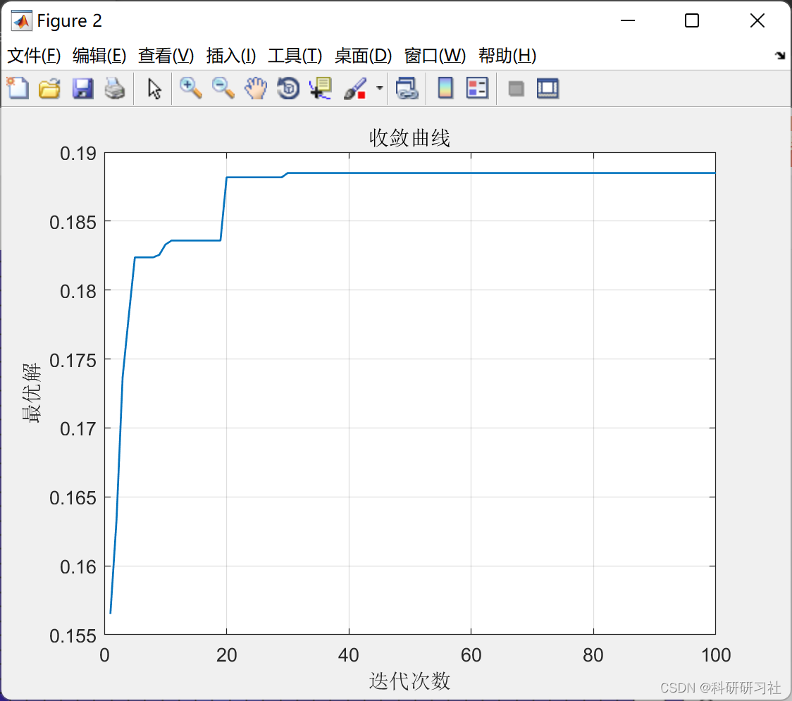
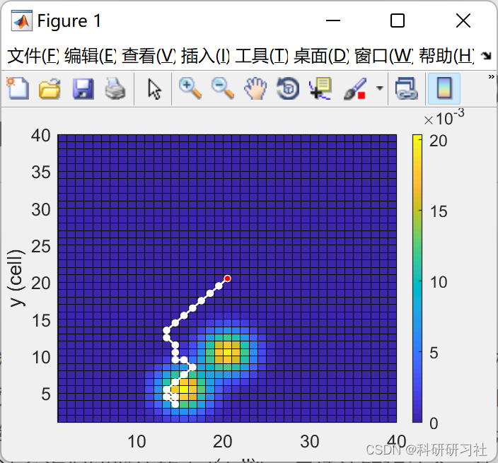
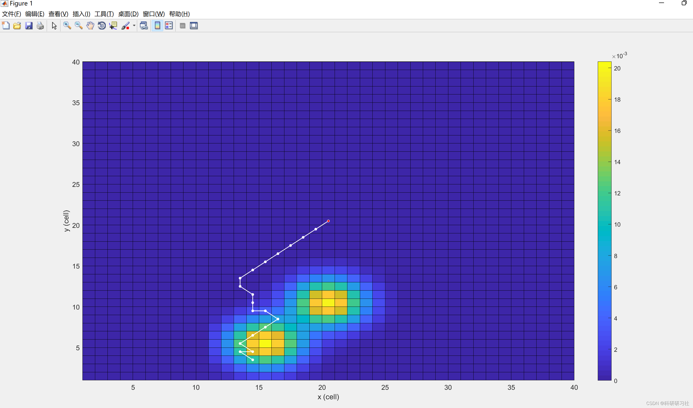
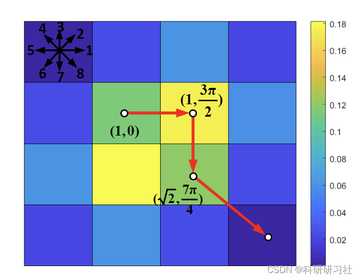

# UAV Motion Target Tracking with Particle Swarm Optimization (MPSO) - MATLAB Code Implementation

​  
Contents
1. Overview
2. Running results
3. Matlab code and detailed article
4 Conclusions
5. References
6. Conclusion
1. Overview of the paper presents a novel algorithm for motion-coded Particle Swarm Optimization (MPSO) for the purpose of finding moving targets in unmanned aerial vehicles (UAVs). From Bayesian theory, the search problem can be transformed into the optimization of a cost function representing the probability of detecting a target. Here, the MPSO developed by encoding the search trajectory as a series of UAV movement paths evolved during the particle generation process in the PSO algorithm addresses this issue. This motion coding method allows for the preservation of important attributes of the population, including cognitive and social cohesion, thereby producing better solutions. Compared to the original PSO, extensive simulation results show that the proposed MPSO improves detection performance and time performance by 4.71 times over the original PSO, and also outperforms other state-of-the-art metaheuristic optimization algorithms, including Artificial Bee Colony (ABC), Ant Colony Optimization (ACO), Genetic Algorithm (GA), Differential Evolution (DE), and Tree Search Algorithm (TSA) in most search scenarios. Real UAV experiments have been conducted to find dynamic targets in different scenarios, demonstrating the advantages of MPSO in practical applications.
The rest of this article is structured as follows: Section 2 outlines the steps to define the objective function. Section 3 introduces the proposed MPSO and its implementation for solving complex search problems. Section 4 provides case studies and experimental results. The conclusion is drawn in Section 5.
Editor
Editor
Editor
3. Matlab code and detailed article. This article only displays a part of the code, all code and articles can be found in:
\n\nfunction PlotSolution(tour,model)\n    \n    MAP_SIZE = model.MAPSIZE;\n    N = model.n; % Path length\n    x = 1:1:MAP_SIZE; y = 1:1:MAP_SIZE; % x & y from 0 to 20\n    [X,Y] = meshgrid(x,y); % Replicate x & y to create a rectangular grid (X,Y) \n    clf('reset');\n    h = pcolor(X,Y,model.Pmap);\n    hold on;\n    \n    tourX =  tour(:,1) + model.xmax + 0.5;\n    tourY = tour(:,2) + model.ymax + 0.5;\n    \n    plot(tourX,tourY,'w-o',...\n        'MarkerSize',3,...\n        'MarkerFaceColor','w',...\n        'LineWidth',1);\n\n    plot(tourX(1),tourY(1),'r-o',...\n        'MarkerSize',2,...\n        'MarkerFaceColor','r',...\n        'LineWidth',1);\n      \n    xlabel('x (cell)');\n    ylabel('y (cell)');\n    \n    % Set properties\n    set(h,'linewidth',0.1);\n    cb = colorbar; \n    cb.Ruler.Exponent = -3;\n    gcaP=get(gca,'position');\n    cbP=get(cb,'Position');\n    cbP(3)=cbP(3)/2; % change the colorbar width\n    set(cb,'Position',cbP)\n    set(gca,'position',gcaP)\n    set(gcf,'position',[300,100,350,250]); % Set the map size\n\nend\n  
4 Conclusions Through extensive simulations, comprehensive comparisons, and experiments, it is evident that MPSO demonstrates superior performance in most search scenarios compared to other state-of-the-art heuristic algorithms and is suitable for practical drone search operations. The success of MPSO lies in its motion encoding mechanism, which prevents the algorithm from generating invalid paths during the search process, thereby avoiding the need for reinitialization, thus accelerating convergence. The motion encoding mechanism also allows MPSO to search in the motion space rather than the Cartesian space, enhancing search performance and better adapting to target dynamics. This advantage is clearly reflected in the good search results of MPSO for challenging scenario 4, where the target moves in the opposite direction to the search path requiring the drone to turn around. However, like PSO, if the search dimensions increase [37], MPSO may require an increase in both population size and iterations. In these scenarios, parallel implementations are necessary to effectively reduce computational time, thereby enhancing the scalability of the proposed algorithm in large-scale systems. In real search scenarios, target dynamics can vary depending on the application, so the deterministic assumptions used in this study may be beyond their validity. In such cases, a predictive mechanism using best estimaters such as Kalman filters [38] could be employed to provide predictions for the target trajectory. These predictions are then used to calculate the cumulative probability used in the MPSO objective function.
5 References Yu Hanqing, Lin Yan, Jia Linqiong, Li Qiang, Zhang Yijin. Communication-constrained multi-objective rescue of unmanned aerial vehicle clusters: A distributed strategy [J]. Journal of Internet of Things, 2022, 6(03):103-112.

## Images

<!-- PAYMENT_BLOCK -->

## Get this dataset

- Payment link (Stripe): [Buy now](https://buy.stripe.com/3cs8yP7sY87d0vu9AB)
- Payment QR code: 

<!-- /PAYMENT_BLOCK -->
